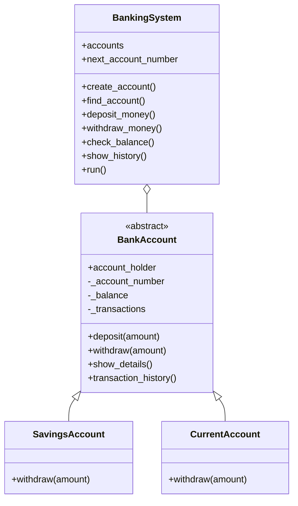

# Python Banking System - Class Diagram

## Architecture

## Class Descriptions

### BankAccount
The base abstract class that stores common account information and provides deposit, balance and transaction history methods.

### SavingsAccount
Inherits from BankAccount and implements withdrawal functionality.

### CurrentAccount
Inherits from BankAccount and implements withdrawal functionality.

### BankingSystem
Manages account creation, deposits, withdrawals, account details and transaction history.

## OOP Relationships

- Inheritance: SavingsAccount and CurrentAccount inherit from BankAccount.
- Encapsulation: Account information is controlled through class attributes and methods.
- Abstraction: BankAccount defines a common abstract withdrawal method.
- Polymorphism: Different account classes implement their own withdrawal methods.
